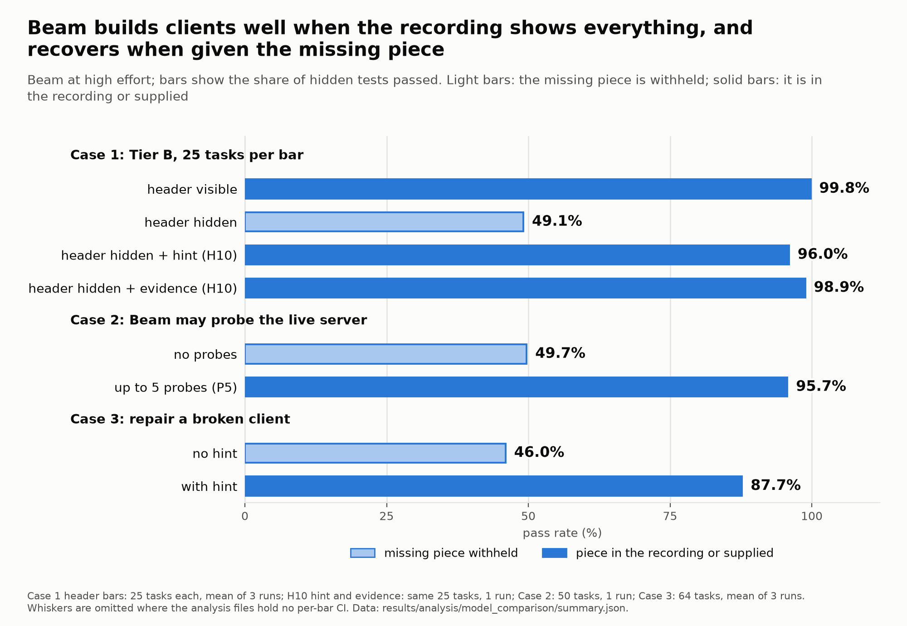
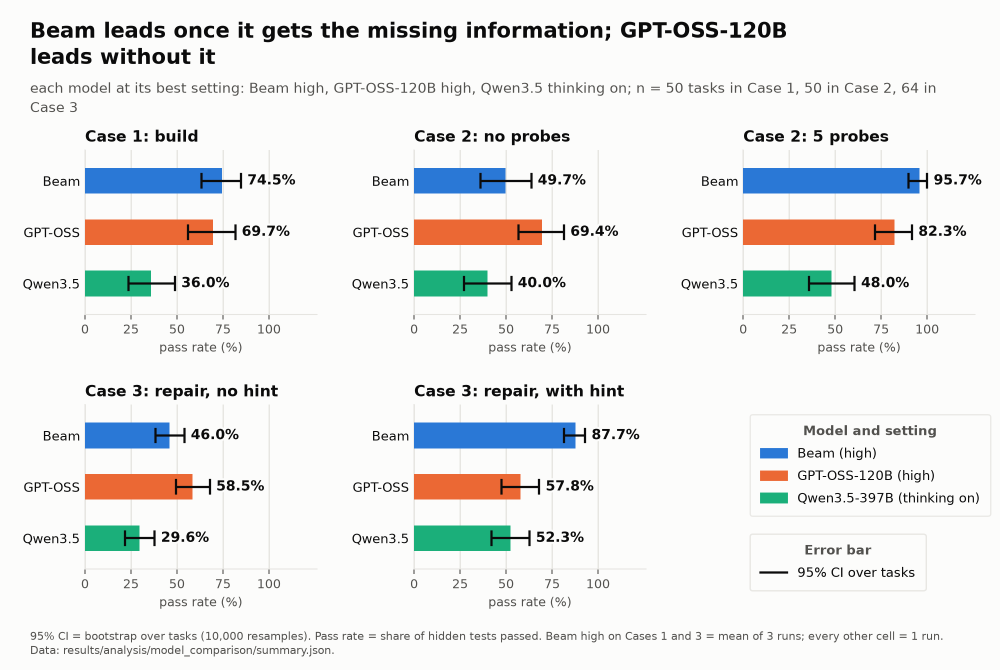

# HAR2Client

**A benchmark and RL environment for one skill: read recorded HTTP traffic, write an API client that works.**


[Dataset](https://huggingface.co/datasets/Rockerleo/har2client) | [Leaderboard Space](https://huggingface.co/spaces/Rockerleo/har2client-leaderboard) | [Docs](docs/README.md) | [Pre-registration](har2client/PREREG.md)



Many services do not document their API. A developer records the traffic of the website or the app (a HAR file), then writes code that makes the same calls. HAR2Client measures how well a model does this step. The model gets a goal and a recording and writes `client.py`. We run that file against a fresh fake server, with new data and new credentials, and count how many hidden tests pass. There is no LLM judge. Code that only replays the recording fails.

The benchmark has three cases:

- **Case 1, build.** Goal and recording in, `client.py` out. Tier A is 30 tasks drawn from 165 usable real public APIs (OpenAPI specs from APIs.guru, a fake server built from each); 27 are in the public dataset. Tier B uses 50 invented stateful APIs with six switches (login type, paging, token expiry, version check, hidden header, response envelope).
- **Case 2, investigate.** The model may also send a few test requests to a practice server before it writes the client. Arms: no probes (placebo), up to 5 probes (P5), up to 20 probes (P20).
- **Case 3, maintain.** The model gets `client_v1.py`, the error output on the changed API and a short new recording. It repairs the client in one call, with no tools and no retries. The suite has 64 tasks in 7 families and ten kinds of change, five of them silent (the server answers 200, but the data looks different).

The model under test is **Beam-1.0-501B-A23B** (Reflection, a Mixture-of-Experts model, 501B parameters, 23B active). It is compared with GPT-OSS-120B and Qwen3.5-397B-A17B. This repository is an entry for the Reflection x Hugging Face "Build with Beam" challenge.

## Results at a glance

Mean pass rate (share of hidden tests passed). Beam (high) on case 1 and case 3 is the mean of 3 runs per task. Beam's case 2 and every other model are 1 run per task. Source: [har2client/results/analysis/model_comparison/report.md](har2client/results/analysis/model_comparison/report.md).

| Benchmark | Beam (high) | GPT-OSS-120B (high) | Qwen3.5-397B-A17B (thinking on) |
|---|---|---|---|
| Case 1, Tier B (50 tasks) | 74.5% | 69.7% | 36.0% |
| Case 2, no probes (50 tasks) | 49.7% | 69.4% | 40.0% |
| Case 2, up to 5 probes (50 tasks) | 95.7% | 82.3% | 48.0% |
| Case 3, base (64 tasks) | 46.0% | 58.5% | 29.6% |
| Case 3, with hint (64 tasks) | 87.7% | 57.8% | 52.3% |

Beam (high) is first on three of the five (on case 1 the gap to GPT-OSS-120B is inside the 95% interval). GPT-OSS-120B (high) is first on case 3 base and on the case 2 no-probe arm. Qwen3.5-397B-A17B is last of the three on all five. The low and medium effort rows, the intervals and the token counts are in [har2client/MODEL-COMPARISON.md](har2client/MODEL-COMPARISON.md). More detail on Beam (effort levels, header split, hint controls, repeat runs, case 2 tests): [docs/results.md](docs/results.md).



## Quickstart

You need Python 3.12 and [uv](https://docs.astral.sh/uv/).

```bash
git clone https://github.com/MohitGoyal09/har2client && cd har2client/har2client
uv sync
```

**Grade a reference client. No API key, no model call.** Build one Tier B task and grade its reference client (expect `pass_rate=1.000`):

```bash
uv run python scripts/build_tierb.py --out runs/quickstart/tierB --seed 1 --limit 1 --configs runs/quickstart/tierb_configs.jsonl
T=runs/quickstart/tierB/tierb_00_invoices
uv run har2client grade $T $T/ref_client.py
```

Tier A works the same way, from a real public spec (this one downloads the spec from APIs.guru):

```bash
uv run python scripts/fetch_spec.py up.com.au
uv run har2client build data/specs/up.com.au.json --api-id up.com.au --out runs/quickstart/tierA --noise 0.7 --seed 1
uv run har2client ref runs/quickstart/tierA/up.com.au
uv run har2client grade runs/quickstart/tierA/up.com.au runs/quickstart/tierA/up.com.au/ref_client.py
```

**Run a model.** Build the task sets once. They are not in the repo (`runs/` is git-ignored), but they rebuild from fixed seeds:

```bash
uv run python scripts/build_tierb.py --out runs/tierb50 --seed 1 --configs runs/tierb50_configs.jsonl
uv run python scripts/build_heal_v3.py --suite eval --out runs/heal_v3_eval --seed 2
```

Put your key in `har2client/.env` (git-ignored; copy `har2client/.env.example`).

```bash
# Beam: REFLECTION_API_KEY=... in .env
uv run python scripts/run_batch.py --tasks runs/tierb50 --out runs/batch/beam_tierb50 --effort low medium high --runs 1 --concurrency 4

# Open models through the Hugging Face router: HF_TOKEN=... in .env
uv run python scripts/run_models.py --dry-run                                          # plan and cost, no calls
uv run python scripts/run_models.py --models gpt-oss-120b --suites tierb50 --limit 1   # smoke test, 1 task
uv run --extra plots python scripts/analyze_models.py                                  # report and charts next to Beam
```

Any other OpenAI-compatible endpoint works with `run_batch.py --solver openai_compat --base-url ... --model ... --api-key-env ...`. Every script is described in the [developer guide](har2client/README.md). Run the tests with `uv sync --extra plots --group dev && uv run pytest -q -m "not slow"`.

## How Beam was used

- **API.** Model `Beam-1.0-501B-A23B` through Reflection's OpenAI-compatible API, `https://api.reflection.ai/openai/v1`. We set `reasoning_effort` to `low`, `medium` or `high` on every call.
- **Beam is the model under test in all three cases.** Case 1: it builds an API client from recorded traffic (one call, no tools). Case 2: it probes a live practice server with a tool-calling agent. Case 3: it repairs a client after the API changed (one call, no tools, no retries). Five of the ten kinds of API change in case 3 are silent: the server answers 200 but the data looks different.
- **Multi-turn tool calling (case 2).** The agent has two tools: `http_request` (to the practice server) and `submit_client` (ends the episode). The `reasoning_content` of every assistant turn is sent back in the next request (`har2client/src/har2client/solve/beam_agent.py`). The placebo arm has no `http_request` tool; the P5 and P20 arms allow up to 5 and 20 requests.
- **Grading.** Hidden tests run the submitted client on a fresh server. No LLM judge.
- **Pre-registered.** Hypotheses, metrics and thresholds were written in [har2client/PREREG.md](har2client/PREREG.md) before the runs. Every later change is in its deviations log. High effort in case 1 Tier B and case 3 is the mean of 3 runs per task.

## Use as an RL environment

Case 1 and case 3 each have an environment. An episode is: observe, then submit one client. The reward is the `pass_rate` on a fresh grading instance, with penalties (hard-coded secrets or hosts, invented endpoint calls; see [docs/design/DESIGN-RL.md](docs/design/DESIGN-RL.md)). Case 2 adds probe actions (`probe_budget > 0`).

```python
from har2client.env.env import TrafficToClientEnv
from har2client.env.repair_env import RepairEnv


def main() -> None:
    # Case 1: observed traffic -> client
    env = TrafficToClientEnv(source="browser_har", split="train", curriculum="L0", compact=True, seed=0)
    obs = env.reset()  # task_id, goal, observation (the recording), observation_format, probe_budget, source
    out = env.step({"type": "submit", "code": env.reference_code()})  # replace with your model's code
    print("case 1 reward:", out["reward"], "done:", out["done"])  # 1.0 for the reference client
    env.close()

    # Case 3: repair a client after the API changed
    repair = RepairEnv(split="train", curriculum="R0", seed=0)
    obs = repair.reset()  # task_id, goal, client_v1, failure, observation, observation_format
    out = repair.step({"type": "submit", "code": obs["client_v1"]})  # a no-op patch: fails some tests
    print("case 3 reward:", out["reward"], "regression:", out["info"]["regression_rate"])
    repair.close()


if __name__ == "__main__":  # the grader uses spawned worker processes: keep this guard
    main()
```

Save it as `demo_env.py` in `har2client/` and run `uv run python demo_env.py`. It uses no model and no network. TRL GRPO reward functions are in `har2client.env.trl` and `har2client.env.repair_env`. The environments are built and tested; no training run is reported. Run RL training with the grader in a container: see [Limitations](#limitations).

## How grading works

- **Fresh server.** The grader starts a new fake server with new data, a new key and a new host. A client that copies the recording fails.
- **Tests the model does not see.** Each task has hidden tests. They can be rebuilt from public seeds.
- **State checks.** In Tier B and case 3 a test checks the return value, the saved server state and the number of writes.
- **Strict score.** `pass_rate` is the share of tests passed. `strict_pass_rate` also fails a test when the client sends an extra, unrequested call.
- **Validity gates.** The reference client must score 1.0 and the empty client 0.0 on every task. A grader audit injects 25 kinds of fault into correct clients and counts how many the grader catches ([results](har2client/results/grader_audit_set30.md)).

## Why this exists

Tools such as reverse-api-engineer, Integuru and Vercel `derive-client` try to turn traffic into a client with an LLM. None of them publishes an accuracy number. To our knowledge, no earlier benchmark grades traffic-to-client generation with hidden execution tests (see [docs/related-work/](docs/related-work/)). Check the literature again before you cite this claim.

## Limitations

- High effort in case 3 (base and hint) and Tier B is the mean of 3 runs per task. Case 3 at low effort (base and hint) has 2 runs. Every other result is 1 run per task. The pre-registered default was three runs (recorded deviation). Intervals come from bootstrap over tasks only and do not include run-to-run noise.
- Three effort levels only: low, medium and high. The pre-registered xhigh level was dropped on 2026-10-27 (see [har2client/PREREG.md](har2client/PREREG.md), deviations).
- Case 2 is complete (50 tasks) but is 1 run per cell, so its intervals cover variation over tasks only. Its placebo arm is far below case 1 on the same tasks, partly because of the submission-tool interface, and the pre-registered hypothesis H11 is not supported (see [docs/results.md](docs/results.md)).
- The APIs are synthetic. Tier B and case 3 are controlled stateful APIs, not the real world. Tier A recordings are synthetic too.
- Other models: GPT-OSS-120B at low, medium and high (explicit `reasoning_effort`, Novita) and Qwen3.5-397B-A17B with thinking enabled (no matched effort level). They run 1 time per cell, capped at 32,768 output tokens against 65,536 for Beam. Beam (high) is the mean of 3 runs. Case 2 is compared on the placebo and P5 arms. Results: [har2client/MODEL-COMPARISON.md](har2client/MODEL-COMPARISON.md) (providers, run counts, caps). One observation from a single run: GPT-OSS gains about 15 points from the contract hint on case 3 at low and medium effort, and none at high (base 58.5%, hint 57.8%).
- We tuned the tasks on Beam. Task design and the hint wording were shaped by how Beam failed in pilots.
- The grader runs client code in a child process. It is not an OS sandbox. Run RL training in a container.

## Repository layout

```
README.md, LICENSE, LICENSE-DATA.md, NOTICE, CITATION.cff, CONTRIBUTING.md, SECURITY.md
docs/
  README.md           index of the documentation
  architecture.md     how the system works, plain language first
  results.md          detailed Beam results
  design/             design notes: Tier A, Tier B, cases 2 and 3, RL environment
  related-work/       literature reviews
har2client/           code, data, tests and results
  README.md           developer guide
  PREREG.md           hypotheses written before the runs, and the deviations log
  MODEL-COMPARISON.md Beam against GPT-OSS-120B and Qwen3.5-397B-A17B: method and results
  src/har2client/     package: builders, mock server, graders, solvers, RL environments
  scripts/            build, run, score, analyse and plot
  results/            result tables, reports and figures (index: results/README.md)
release/              Hugging Face release kit: dataset export, leak check, Croissant, leaderboard Space
```

## Licences

- **Code:** Apache-2.0 ([LICENSE](LICENSE)).
- **Dataset and results:** CC-BY-4.0 (the released dataset and `har2client/results/`; see [LICENSE-DATA.md](LICENSE-DATA.md)).
- **Third-party material** (details in [NOTICE](NOTICE)):
  - OpenAPI specs from APIs.guru keep their own licences. Each Tier A task records its spec licence in the `spec_license_*` fields. 3 specs with a restrictive licence were dropped from the release. 20 of the 27 kept specs declare no licence; they stay, with a note in the dataset card.
  - Beam outputs were produced through Reflection's API and are under Reflection's terms.
  - GPT-OSS-120B and Qwen3.5-397B-A17B outputs (both Apache-2.0 models) were produced through the Hugging Face router.

## Citation

To cite this work, use [CITATION.cff](CITATION.cff).

```bibtex
@misc{har2client2026,
  title  = {har2client: a benchmark and environment for turning recorded API traffic into working clients},
  author = {Goyal, Mohit and Bhattacharya, Ananya},
  year   = {2026},
  url    = {https://github.com/MohitGoyal09/har2client}
}
```

## Authors

Mohit Goyal and Ananya Bhattacharya. Contact: goel0632@gmail.com, bhattacharya.ananya004@gmail.com. To report a vulnerability, see [SECURITY.md](SECURITY.md).
