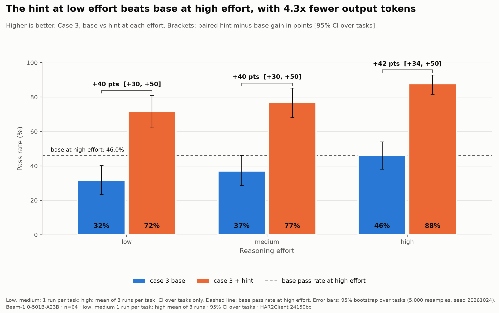
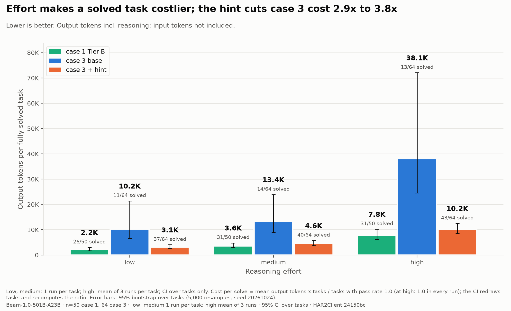
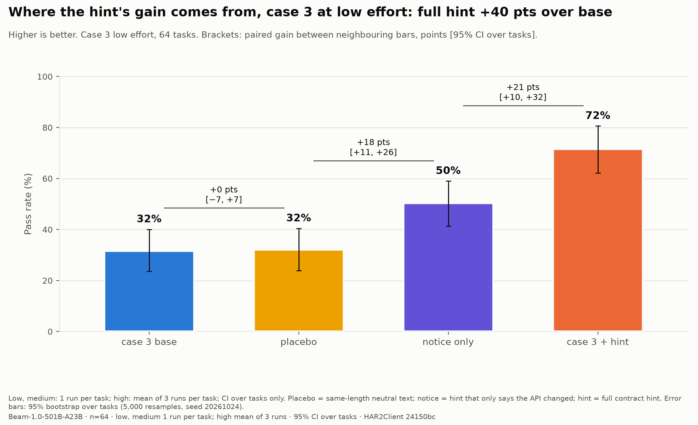

# Detailed results

Numbers behind the tables in the [front page](../README.md). Every number comes from the files under [`har2client/results/`](../har2client/results/).

## Beam in detail

Beam-1.0-501B-A23B at three effort levels: low, medium and high. At high effort, case 3 (base and hint arms) and Tier B are the mean of 3 runs per task. Case 3 at low effort (base and hint arms) has two runs. Every other result is one run per task. The pre-registered default was three runs; the change is recorded in [har2client/PREREG.md](../har2client/PREREG.md) (deviations). Mean pass rate (share of hidden tests passed). Source: [har2client/results/analysis/](../har2client/results/analysis/) and the CSV files in [har2client/results/](../har2client/results/).

| Suite | Tasks | low | medium | high (mean of 3 runs) |
|---|---|---|---|---|
| Case 1, Tier B | 50 | 57.1% | 63.7% | 74.5% |
| Case 3, base | 64 | 31.6% | 37.0% | 46.0% |
| Case 3, hint | 64 | 71.6% | 76.9% | 87.7% |

Tasks repaired in full (all 17 tests pass), case 3: base 11 / 14 / 13, hint 37 / 40 / 43 (of 64). At high effort a task counts as repaired only if all 3 runs pass all 17 tests, so the high count is stricter than the low and medium counts.

Mean output tokens per task (reasoning included):

| Suite | low | medium | high (mean of 3 runs) |
|---|---|---|---|
| Case 1, Tier B | 1,154 | 2,259 | 4,818 |
| Case 3, base | 1,758 | 2,922 | 7,746 |
| Case 3, hint | 1,800 | 2,846 | 6,824 |

- **Tier B, header split.** 25 of the 50 tasks use a hidden required header. The model scores 94-100% on the 25 tasks without it and 20-49% on the 25 with it (high effort is the mean of 3 runs). The header is a feature we invented. Pre-registered test H10 (supported): on the 25 hidden-header tasks at high effort, the as-built goal scores 49.1% (mean of 3 runs), a goal with a one-line hint scores 96.0% (1 run), and a recording that shows a failed call scores 98.9% (1 run). Evidence beats the hint by a small margin, and the hint alone reaches 96.0%, so the header gap is a prompting effect.
- **Case 3, floor.** The unchanged old client scores about 6.5% on the 64 tasks, and the empty client scores 0.0. So the base arm starts from a low floor.
- **Case 3, hint.** The hint arm adds one paragraph to the goal. The paragraph warns that the wire format may have changed and says how to adapt, so it adds information as well as a warning. Controls at low effort separate the two parts (paired by task, 64 tasks, points, 95% CI):

  | Contrast | Gain |
  |---|---|
  | placebo minus base | +0.5 [-6.7, +7.4] |
  | notice-only minus base | +18.7 [+10.0, +27.6] |
  | hint minus placebo | +39.5 [+30.0, +49.2] |

  The placebo is a neutral paragraph of the same length. The notice-only paragraph says only that the API changed. H22 is supported: length alone does nothing, and the hint adds 39.5 points. H23 is inconclusive: notice-only is +18.7, just under the 20-point bar, with a CI that excludes 0. The hint beats notice-only by +21.3 [+10.6, +32.1], so the warning gives about half of the hint gain and the content of the paragraph gives the rest.
- **Case 3, repeat runs.** At low effort, a second run moves the mean by at most 1.1 points (base 31.6% to 32.1%, hint 71.6% to 70.5%). Per-task scores are noisy: the share of tasks whose full-repair status flips between the two runs is 9.4% for base and 26.6% for hint. Read the claims as claims about means, not about single tasks.
- **Case 3 and Tier B, repeat runs at high.** High effort has three runs per task, and the high scores above are the mean of the three. The run means move by up to 8 points: case 3 base 42.7%, 47.1%, 48.2%; case 3 hint 90.6%, 85.0%, 87.5%; Tier B 78.0%, 70.0%, 75.4%. No difference from run 1 has a CI that excludes 0. The per-task standard deviation over the 3 runs is 15.9 points for base, 9.7 for hint and 9.6 for Tier B, and 13% to 15% of tasks change full-repair status between runs.

Tier A (30 tasks from real public APIs) is nearly solved: 96.3% at low and 99.6% at high effort. It is the easy baseline.

| Hint against base, by effort | Output tokens against solved tasks |
|---|---|
|  |  |

## Case 2: probing a practice server

The model may also send a few test requests to a practice server before it writes the client. The run is complete: all 50 Tier B tasks, 3 arms, 3 effort levels, 1 run per cell (450 cells). The report is [har2client/results/case2_probe/main_full/REPORT.md](../har2client/results/case2_probe/main_full/REPORT.md). At high effort the pass rate is 49.7% for the no-probe placebo, 95.7% for up to 5 probes (P5) and 98.0% for up to 20 probes (P20). P20 minus placebo is +48.3 points [32.9, 62.6]. When the hidden header is on, the gain is +64.0 [40.0, 84.0] (placebo 32.0%, P20 96.0%). When it is off, the gain is still +32.6 [16.0, 50.3] (placebo 67.4%, P20 100.0%). H11 is **not supported**: the first part is met (at least 20 points on header-on tasks), but the header-off control fails (the gain should be under 5 points). A post-hoc check (tasks 20-49 only, not pre-registered) found that the placebo arm often ends its code with a stray closing `"""` (15 of 89 clients, against 3 of 90 for P5 and for P20); removing it halves the header-off gain, which stays above 5 points ([SENSITIVITY.md](../har2client/results/case2_probe/main_full/SENSITIVITY.md)). The placebo at high effort (49.7%) is far below case 1 Tier B as built (74.5%, mean of 3 runs) on the same tasks. The submission-tool interface in case 2 is one known reason. One placebo cell produced no code (it hit the output-token cap) and counts as zero. Case 2 is 1 run per cell; repeat runs are deferred (see PROTOCOL.md). Tasks 00-19 ran on one machine and tasks 20-49 on a second, from the same frozen runtime archive (hashes checked).
